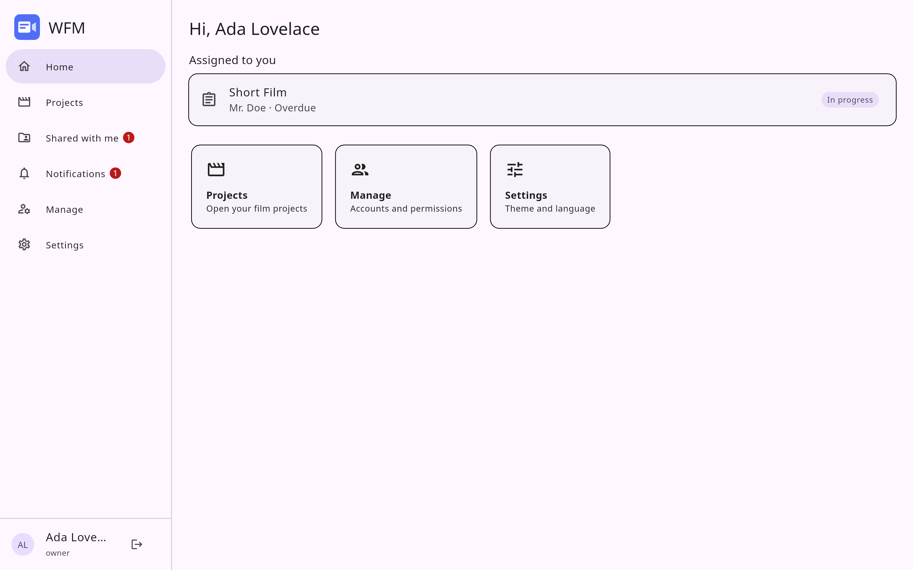
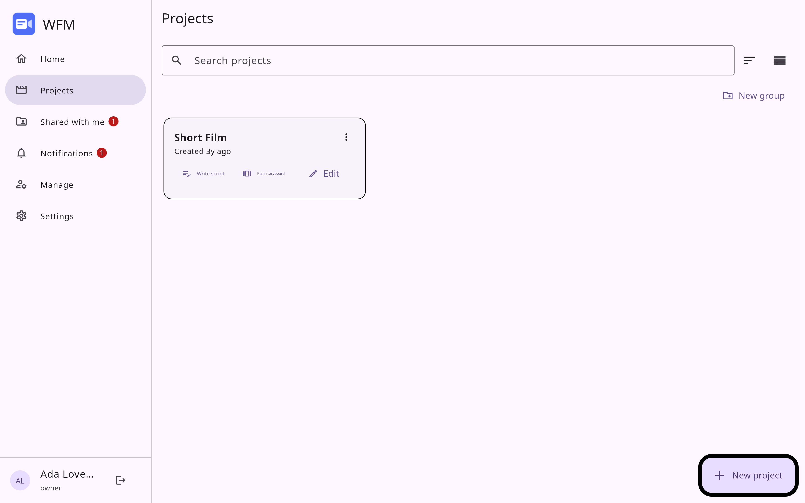
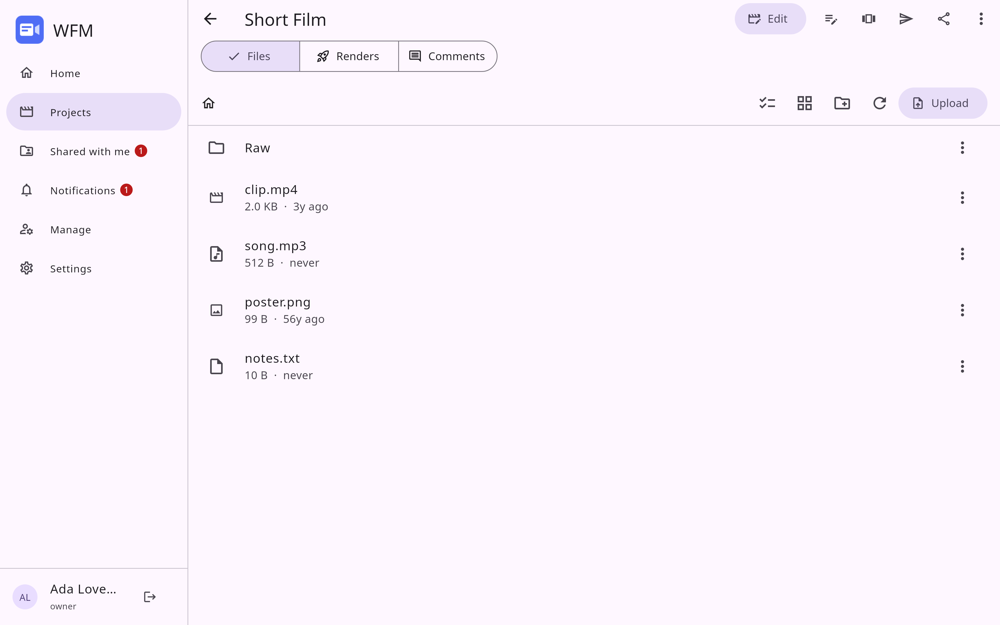

# WFM - Web Film Manager

[](https://gitlab.com/HttpAnimations/wfm/-/pipelines)
[](https://gitlab.com/HttpAnimations/wfm/-/releases)
[](LICENSE)
[](https://httpanimations.gitlab.io/wfm/)

Self-hosted media project manager built for a school film program. Students
upload footage, write scripts in [ScriptCraft](https://github.com/NoJuanNobody/scriptcraft),
plan storyboards in [DeckCraft](https://github.com/storytold/deckcraft), edit in
the browser with [FilmCraft](https://github.com/storytold/filmcraft), and queue
renders on the server. Teachers manage accounts, assignments and the audit log.

- **Site:** https://httpanimations.gitlab.io/wfm/ (app at [/app/](https://httpanimations.gitlab.io/wfm/app/))
- **Releases:** https://gitlab.com/HttpAnimations/wfm/-/releases
- **Mirror:** https://github.com/justacalico/wfm

| Home | Projects | Files |
|---|---|---|
|  |  |  |

## Layout

- `server/` - Rust (axum) backend: auth, projects, file API, render queue, audit
- `lib/` - Flutter web app, embedded into the server binary
- `filmcraft/`, `scriptcraft/`, `deckcraft/` - pinned craft sources, patches and
  the `wfm.html` host page (locks, media bin, saves)
- `server/migrations/{sqlite,postgres}/` - plain `.sql` migrations, applied in filename order
- `landing/` - small standalone landing page (optional)
- `deploy/` - ready-to-run compose file using the published image
- `scripts/` - `build-<craft>.sh` for each craft, `build-web.sh`

## Quick start (Docker)

Prebuilt images live in GitLab's container registry (built on every push to
`main` and every release tag). One container, one volume:

```sh
docker run -d --name wfm -p 8080:8080 -v wfm-data:/data \
  registry.gitlab.com/httpanimations/wfm:latest
```

Open http://localhost:8080 and create the owner account. Everything (SQLite
database and media files) persists in the `wfm-data` volume.

Or with compose: grab [`deploy/docker-compose.yaml`](deploy/docker-compose.yaml)
and run `docker compose up -d` next to it. To update later:

```sh
docker compose pull && docker compose up -d
```

### TrueNAS SCALE

Apps > Discover Apps > Custom App:

- Image repository: `registry.gitlab.com/httpanimations/wfm`, tag `latest`
- Port forwarding: container `8080` to a host port you like
- Storage: a host path (dataset) mounted at `/data`

Everything works out of the box with those three settings. To update, edit
the app and repull `latest`, or pin a version tag such as `v0.3.0`.

### Build from source

The root `docker-compose.yml` builds the whole stack locally (RustFS plus a
from-source WFM image, about 40 minutes the first time):

```sh
cp .env.example .env   # set real secrets
docker compose up --build
```

## Quick start (dev)

```sh
./scripts/build-web.sh          # builds the Flutter app into server/web/app
cd server && cargo run          # sqlite + local media dir by default
```

The app is at `/app/`; the craft bridges live at `/filmcraft/wfm.html`,
`/scriptcraft/wfm.html` and `/deckcraft/wfm.html`, all taking `?project=<id>`.

## Configuration

Everything is a flag or env var (`wfm --help`):

- `WFM_DB` - `sqlite:<path>` (default) or `postgres://...` (release builds and
  the Docker image include postgres; source builds need `--features postgres`)
- `WFM_MEDIA` - `s3` or `local`; S3 settings via `WFM_S3_*`. Any S3-compatible
  store works: RustFS, MinIO, AWS, Backblaze
- `WFM_RENDER_WORKERS` / `WFM_LOCAL_RENDERS` - local ffmpeg workers
- `WFM_FFMPEG` / `WFM_FFPROBE` - binary paths
- `WFM_WEB_DIR` / `WFM_FILMCRAFT_DIR` / `WFM_SCRIPTCRAFT_DIR` /
  `WFM_DECKCRAFT_DIR` - serve frontends from disk instead of embedded
- `WFM_MAX_UPLOAD_MB`, `WFM_SESSION_DAYS`, `WFM_LOCK_TTL`, `WFM_SECURE_COOKIES`
- `WFM_TRUSTED_PROXIES` - comma-separated proxy IPs/CIDRs. Off by default; when
  set, `X-Forwarded-For` is only honored from those addresses. Owners can
  change it later under Settings > Server, and first-time setup offers it too.

### Databases

Swap engines by pointing `WFM_DB` at another URL. All data access goes through
the `Db` trait (`server/src/store.rs`); migrations are plain `.sql` files under
`server/migrations/<dialect>/` applied in filename order. To add a backend,
implement `Db` and register it in `store::connect`.

### Media storage

`WFM_MEDIA=s3` talks S3 to any compatible service (RustFS is the default in
compose). `WFM_MEDIA=local` keeps files under `WFM_MEDIA_PATH`. Because both the
database and the media are external, a reinstall only needs the DB dump and the
bucket contents.

### Remote render nodes

Create a node under Manage > Render nodes, then on the worker machine:

```sh
WFM_WORKER_TOKEN=<token> wfm --worker http://<wfm-host>:8080 <name>
```

(Passing the token positionally still works — `wfm --worker <url> <token> <name>` —
but puts it in `ps` output and shell history.)

The node polls for jobs, downloads inputs, runs ffmpeg, and uploads the export.

## Roles

`student` < `mod` < `teacher` < `admin` < `owner`. Each account belongs to the
tree of whoever created it; managers only see their own subtree. The first
account created at `/api/setup` is the owner. Projects can be shared with
other accounts through invites or scoped share links. Teachers can mark a
project as a template and assign it to students; each student works in their
own copy and submits it for review, with optional due dates and attempt
limits.

## Craft apps

Three embedded editors are pinned and built the same way: upstream source is
fetched at the version in `<craft>/VERSION`, patched with `<craft>/patches/`,
and bundled into the server binary (`./scripts/build-<craft>.sh`):

- **FilmCraft** - timeline video editor; saves `project.fcproj`
- **ScriptCraft** - Fountain screenwriting; saves `Script/script.fountain`
- **DeckCraft** - storyboards and slide decks; saves `Boards/boards.deckcraft`

Each `<craft>/wfm.html` host page acquires the project edit lock, serves
project media, and saves back to project storage. Projects are locked while
open; a second tab gets a take-over prompt.

## Interface

The Flutter web UI ships English (incl. en_GB), Chinese, Russian and Irish,
plus system/light/dark/OLED themes. Settings has an update checker that reads
GitLab releases.

## Testing

```sh
cd server && cargo test     # unit tests (paths, ranges, roles, ffmpeg args)
flutter test --coverage     # unit + widget + golden tests, 100% line coverage
flutter test --update-goldens   # regenerate golden PNGs under test/goldens/
```

CI requires the coverage gate and `dart format` to stay clean.

## License

AGPL-3.0
